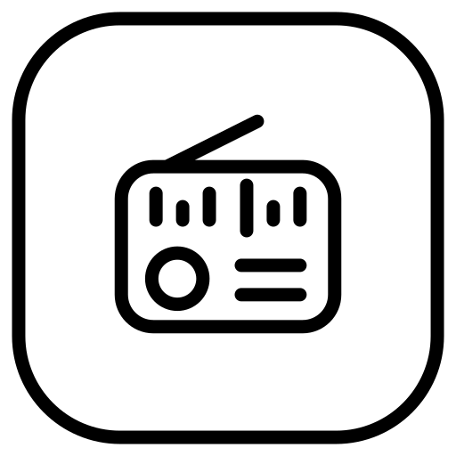

# Radio

Internet radio and podcasts for the Mudita Kompakt, designed for E Ink: black and white, no animations, no account.

## What it can do

**Radio**
- Search stations by name, or browse by country, genre and language
- Advanced search that combines several criteria
- Favorites with their own search
- Add your own stream links, typed in or scanned from a QR code

**Podcasts**
- Follow any podcast by its RSS or Atom address
- Import and export your podcast list as an OPML file
- Search your podcasts and their episodes
- See which episodes are new, in progress or played, and continue where you left off
- Read episode notes
- Skip back 15 seconds or forward 30 seconds

**Listening**
- Keeps playing with the phone locked
- Sleep timer for radio, podcasts or both
- Your favorites and own links stay available without internet

**Languages:** English, Croatian, Spanish

## Permissions
- Internet: to find stations and play audio
- Camera: only to scan a QR code, while the scanner is open; no picture is saved
- Notifications and background playback: to keep audio playing

The station list comes from the Radio Browser directory.

## Install
Download the latest APK from [Releases](../../releases/latest) and install it on your Kompakt with Mudita Center.
